

<a href="https://coffee1337.github.io/">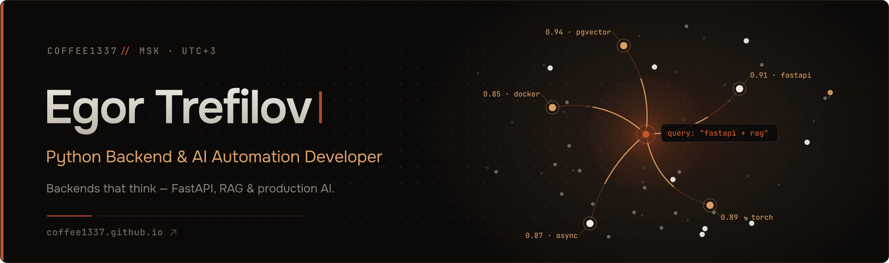</a>

 

&nbsp;&nbsp;&nbsp;&nbsp;&nbsp;

## What I Build

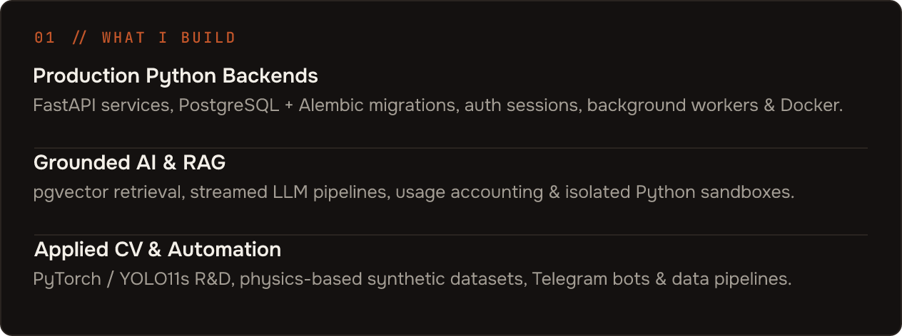&nbsp;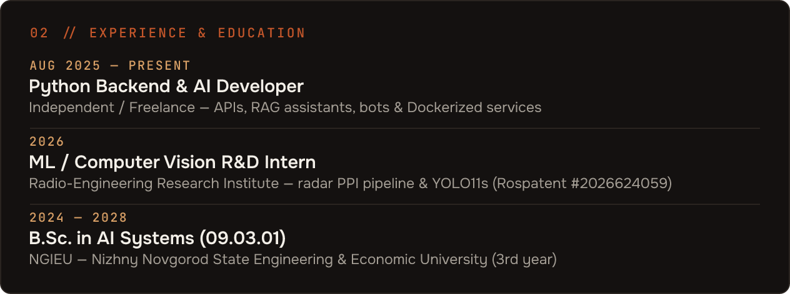

## Selected Work

<a href="https://coffee1337.github.io/projects/ai-python-mentor/">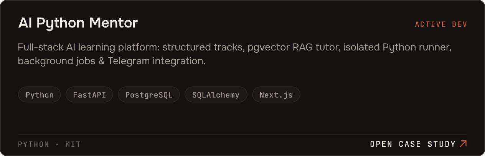</a>&nbsp;<a href="https://coffee1337.github.io/projects/radar-ppi-mtd/">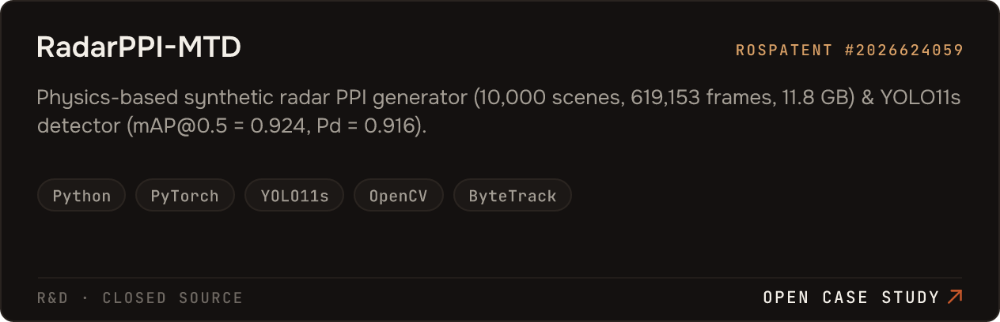</a>

<a href="https://coffee1337.github.io/projects/portfolio-analytics/">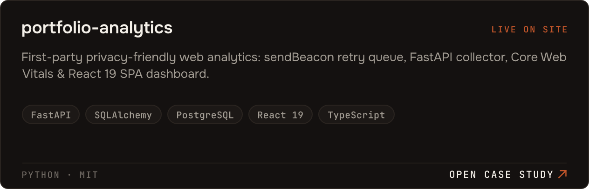</a>&nbsp;<a href="https://coffee1337.github.io/projects/ngie/">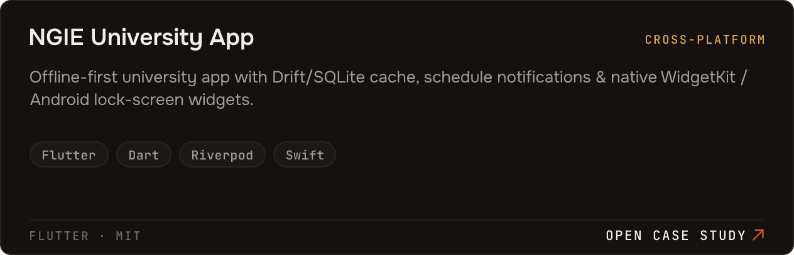</a>

<b>More engineering case studies (3)</b> — TransactionMonitor (.NET 8) · Neural A&#42; Heuristic (PyTorch) · k-NN from Scratch (C++17)

 

**TransactionMonitor** — desktop transaction monitoring and risk analysis: explainable rule-based scoring stored with every transaction, analyst review for high-risk operations and CSV export. C#, .NET 8, WinUI 3, SQL Server.

&nbsp;

---

**Neural A&#42; Heuristic** — a value network trained on backward walks from solved states becomes the A&#42; heuristic (f = g + V); one architecture, three puzzle state spaces. Python, PyTorch, NumPy, Docker.

&nbsp;

---

**k-Nearest Neighbors from Scratch** — k-NN in C++17 with three distance metrics, weighted voting and feature normalisation behind a WinAPI desktop interface. C++17, CMake, WinAPI.

&nbsp;

## Tech Stack

**Backend**

&nbsp;&nbsp;&nbsp;&nbsp;&nbsp;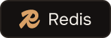&nbsp;

**AI, ML & Data**

&nbsp;&nbsp;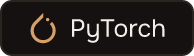&nbsp;&nbsp;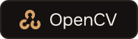&nbsp;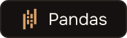&nbsp;

**Cloud & DevOps**

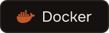&nbsp;&nbsp;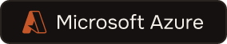&nbsp;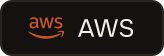&nbsp;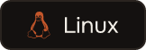&nbsp;

**Frontend, Mobile & Desktop**

&nbsp;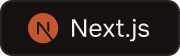&nbsp;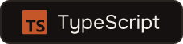&nbsp;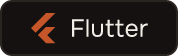&nbsp;&nbsp;

## Credentials & Registered IP

&nbsp;

&nbsp;

&nbsp;<a href="https://www.linkedin.com/learning/certificates/4ca1b7777b424c3d759513f754b34f1897de6d5f41921b8e65b70983d4adc663/">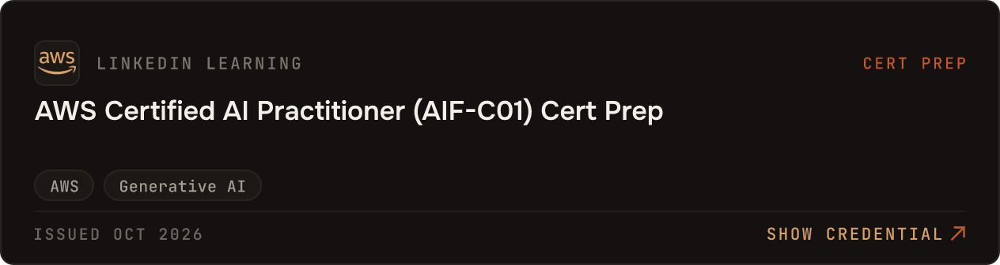</a>

