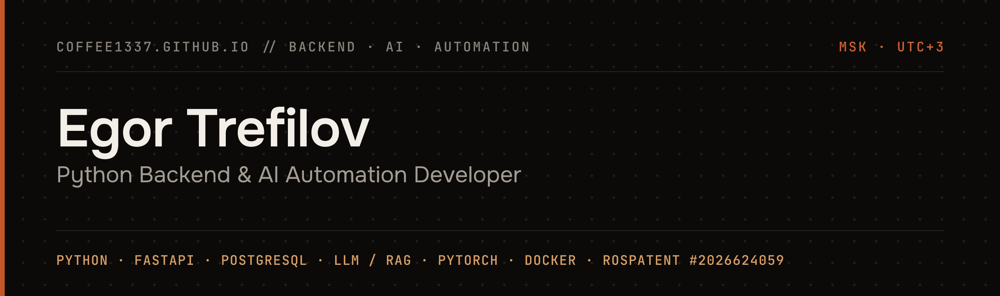

# Egor Trefilov

**Python Backend & AI Automation Developer** · Nizhny Novgorod, UTC+3

[-141110?style=flat-square&color=c4562a&logo=firefoxbrowser&logoColor=f3efe8)](https://coffee1337.github.io/)
[-141110?style=flat-square&color=c4562a&logo=firefoxbrowser&logoColor=f3efe8)](https://coffee1337.github.io/ru/)
[-141110?style=flat-square&color=c4562a&logo=adobeacrobatreader&logoColor=f3efe8)](https://coffee1337.github.io/resume/Egor_Trefilov_Resume_EN.pdf)
[-141110?style=flat-square&color=c4562a&logo=adobeacrobatreader&logoColor=f3efe8)](https://coffee1337.github.io/resume/Egor_Trefilov_Resume.pdf)

[LinkedIn](https://www.linkedin.com/in/coffee1337/) · [Telegram](https://t.me/cooffeek1337) · [trefilovegor84@gmail.com](mailto:trefilovegor84@gmail.com)

---

## About & Experience

- I build **production-oriented Python backends**: FastAPI services, PostgreSQL schemas with Alembic migrations, cookie-auth sessions, background jobs and Docker deployment.
- I fold **LLM / RAG into real products**: a retrieval-grounded tutor over course material in pgvector, per-user AI usage accounting, streamed answers — not a prompt wrapper.
- **Computer Vision R&D**: a physics-based synthetic radar PPI generator, YOLO11s detector training on PyTorch, custom Pd/FPPI radar metrics and ByteTrack association; the resulting dataset is a registered database (Rospatent #2026624059).
- I also ship automation (Telegram bots, parsers, external APIs), desktop (.NET 8 / WinUI 3, C++17) and mobile (Flutter) when the problem lives outside the backend.

**Python Backend & AI Automation Developer — Independent / Freelance** · `Aug 2025 — Present`
Backend services and REST APIs (FastAPI, PostgreSQL, SQLAlchemy, Alembic, auth, background jobs); AI integrations (LLM APIs, RAG pipelines, usage-aware features); automation (Telegram bots, parsers, data-processing scripts).

**ML / Computer Vision R&D Intern — Radio-Engineering Research Institute** · `2026`
Synthetic radar PPI dataset generation, YOLO11s training and radar-specific evaluation; the dataset is registered with Rospatent `#2026624059` at NGIEU.

**Education — NGIEU (Nizhny Novgorod State Engineering and Economic University)** · `2024 — 2028`
B.Sc. in Informatics & Computer Engineering (09.03.01), *Artificial Intelligence Systems*, 3rd year, class of 2028.

---

## Selected Engineering & R&D Work

All seven case studies, in site order. Every entry links to the full write-up on the portfolio.

| # | Project | What it is | Core stack | Links |
|---|---|---|---|---|
| 01 | **AI Python Mentor** | Full-stack AI learning platform: structured paths, a RAG tutor, Python practice in an isolated runner, background jobs, email/Telegram | Python, FastAPI, PostgreSQL, SQLAlchemy, Alembic, Next.js, Docker, RAG | [Case Study](https://coffee1337.github.io/projects/ai-python-mentor/) · [Source](https://github.com/coffee1337/ai-python-mentor) |
| 02 | **RadarPPI-MTD** | Physics-based radar PPI generator with zero-error auto-labelling and a YOLO11s moving-target detector. **10,000 scenes · 619,153 frames · 11.8 GB · YOLO11s mAP@0.5 = 0.924 · Pd = 0.916** | Python, PyTorch, YOLO11s, OpenCV, NumPy, ByteTrack | [Case Study](https://coffee1337.github.io/projects/radar-ppi-mtd/) · [Rospatent #2026624059](https://new.fips.ru/registers-doc-view/fips_servlet?DB=DB&DocNumber=2026624059&TypeFile=html) |
| 03 | **NGIE University App** | Cross-platform Flutter university app: offline Drift/SQLite cache, schedule notifications, native Android/iOS and lock-screen widgets | Flutter, Dart, Riverpod, Drift, SQLite, Kotlin, Swift, WidgetKit | [Case Study](https://coffee1337.github.io/projects/ngie/) · [Source](https://github.com/coffee1337/ngieuapp) |
| 04 | **TransactionMonitor** | Desktop transaction monitoring and risk analysis with explainable rule-based scoring and CSV export | C#, .NET 8, WinUI 3, SQL Server | [Case Study](https://coffee1337.github.io/projects/transaction-monitor/) · [Source](https://github.com/coffee1337/TransactionMonitor) |
| 05 | **Neural A* Heuristic** | A PyTorch value network `V(s)` trained from backward walks becomes the heuristic inside A* (`f = g + V`) across three puzzle environments | Python, PyTorch, NumPy, A*, Docker | [Case Study](https://coffee1337.github.io/projects/neural-astar/) · [Source](https://github.com/coffee1337/neural-astar-heuristic) |
| 06 | **k-Nearest Neighbors from Scratch** | k-NN implemented from scratch in C++17 — three distance metrics, weighted voting, normalisation — with a WinAPI desktop GUI | C++17, CMake, WinAPI | [Case Study](https://coffee1337.github.io/projects/knn/) · [Source](https://github.com/coffee1337/k-nearest-neighbors) |
| 07 | **portfolio-analytics** | First-party analytics for this site: privacy-first beacon, FastAPI collector, Core Web Vitals and a SPA dashboard | Python, FastAPI, SQLAlchemy, PostgreSQL, React, TypeScript, Tailwind CSS, Docker | [Case Study](https://coffee1337.github.io/projects/portfolio-analytics/) · [Source](https://github.com/coffee1337/portfolio-analytics) |

---

## Credentials & Registered IP

> ### State Registration Certificate of Database No. 2026624059 — `RadarPPI-MTD`
> *Rospatent (FIPS), Aug 2026 · Rightholder: NGIEU · 11.8 GB (`Radar PPI Generator v1.0.0`)*
>
> [FIPS Registry ↗](https://new.fips.ru/registers-doc-view/fips_servlet?DB=DB&DocNumber=2026624059&TypeFile=html) · [Certificate PDF ↗](https://coffee1337.github.io/certificates/ru2026624059-certificate.pdf) · [Abstract PDF ↗](https://coffee1337.github.io/certificates/ru2026624059-abstract.pdf) · [Case Study →](https://coffee1337.github.io/projects/radar-ppi-mtd/)

| Credential | Issuer | Issued | Verification |
|---|---|---|---|
| Generative AI Professional Certificate by Snowflake | Snowflake | Nov 2026 | [Verify ↗](https://www.linkedin.com/learning/certificates/7dbcfe3d6e75e230a455c69fc572a2bf422822b777cc40686c8ec1b220177967/) |
| Docker Foundations Professional Certificate | Docker, Inc. | Oct 2026 | [Verify ↗](https://www.linkedin.com/learning/certificates/3da5e65791016cdc89e7f42a986a37c699f119cf7b6f90ac683362857740c3f7/) |
| Microsoft Azure Essentials Professional Certificate | Microsoft | Oct 2026 | [Verify ↗](https://www.linkedin.com/learning/certificates/1e5b63d85c89c9efa42594708e819226f4036646c14fd345356a085d3f5b58e6/) |
| Career Essentials in GitHub Professional Certificate | GitHub | Oct 2026 | [Verify ↗](https://www.linkedin.com/learning/certificates/5ee9bbacfc5a96408649fbb18ec701032c546fcc574f4395c077ae8cef0aed48/) |
| Building AI Agents with Snowflake | LinkedIn Learning · Snowflake | Nov 2026 | [Verify ↗](https://www.linkedin.com/learning/certificates/7432d7674af7d7e569f163ae9668c3a290d63075ec99cac1e8f563783c4bb768/) |
| AWS Certified AI Practitioner (AIF-C01) Cert Prep | LinkedIn Learning | Oct 2026 | [Verify ↗](https://www.linkedin.com/learning/certificates/4ca1b7777b424c3d759513f754b34f1897de6d5f41921b8e65b70983d4adc663/) |

---

## Tech Stack

**Backend**

**AI, ML & Data**

**Cloud & DevOps**

**Frontend, Mobile & Desktop**

---

**[Portfolio](https://coffee1337.github.io/)** · **[Case studies](https://coffee1337.github.io/projects/)** · **[Résumé PDF](https://coffee1337.github.io/resume/Egor_Trefilov_Resume_EN.pdf)** · **[Email](mailto:trefilovegor84@gmail.com)**

MIT licensed · built and verified, not just described.

