

<a href="https://coffee1337.github.io/">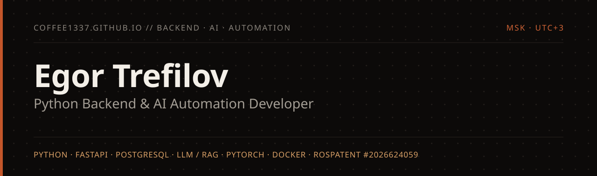</a>

 

&nbsp;&nbsp;&nbsp;&nbsp;&nbsp;&nbsp;&nbsp;&nbsp;&nbsp;&nbsp;

## What I Build

<table>
<tr>
<td width="54%" valign="top">

**Production Python Backends**

`FastAPI` services, `PostgreSQL` + `Alembic` migrations, auth sessions, background workers & `Docker`.

**Grounded AI & RAG**

`pgvector` retrieval, streamed LLM pipelines, usage accounting & isolated code sandboxes.

**Applied CV & Automation**

`PyTorch` / `YOLO11s` R&D, physics-based synthetic datasets, Telegram bots & data pipelines.

</td>
<td width="46%" valign="top">

`Aug 2025 — Present`
**Python Backend & AI Developer**
Independent / Freelance — APIs, RAG assistants, bots & Dockerized services

`2026`
**ML / Computer Vision R&D Intern**
Radio-Engineering Research Institute — synthetic radar PPI pipeline & YOLO11s (`Rospatent #2026624059`)

`2024 — 2028`
**B.Sc. in AI Systems (`09.03.01`)**
NGIEU — Nizhny Novgorod State Engineering & Economic University (3rd year)

</td>
</tr>
</table>

## Selected Work

<table>
<tr>
<td width="50%" valign="top">

**AI Python Mentor**

Full-stack AI learning platform: structured tracks, `pgvector` RAG tutor, isolated Python runner, background jobs & Telegram integration.

`Python` · `FastAPI` · `PostgreSQL` · `SQLAlchemy` · `Next.js` · `RAG` · `Docker`

&nbsp;

</td>
<td width="50%" valign="top">

**RadarPPI-MTD**

Physics-based synthetic radar PPI generator (`10,000` scenes, `619,153` frames, `11.8 GB`) & `YOLO11s` detector (`mAP@0.5 = 0.924`, `Pd = 0.916`).

`Python` · `PyTorch` · `YOLO11s` · `OpenCV` · `NumPy` · `ByteTrack`

&nbsp;

</td>
</tr>
<tr>
<td width="50%" valign="top">

**portfolio-analytics**

First-party privacy-friendly web analytics: `sendBeacon` retry queue, `FastAPI` collector, Core Web Vitals & `React 19` SPA dashboard.

`Python` · `FastAPI` · `SQLAlchemy 2.0` · `PostgreSQL` · `React 19` · `TypeScript` · `Docker`

&nbsp;

</td>
<td width="50%" valign="top">

**NGIE University App**

Offline-first cross-platform university app with `Drift/SQLite` cache, schedule notifications & native `WidgetKit` / Android lock-screen widgets.

`Flutter` · `Dart` · `Riverpod` · `Drift` · `Swift` · `Kotlin`

&nbsp;

</td>
</tr>
</table>

<b>More Engineering Case Studies (3)</b> — TransactionMonitor (.NET 8) · Neural A&#42; Heuristic (PyTorch) · k-NN from Scratch (C++17)

 

<table>
<tr>
<td width="33%" valign="top">

**TransactionMonitor**

Desktop transaction monitoring and risk analysis: explainable rule-based scoring stored per transaction, analyst review & CSV export.

`C#` · `.NET 8` · `WinUI 3` · `SQL Server`

&nbsp;

</td>
<td width="33%" valign="top">

**Neural A&#42; Heuristic**

A value network `V(s)` trained from backward walks becomes the A&#42; heuristic (`f = g + V`); one architecture, three puzzle state spaces.

`Python` · `PyTorch` · `NumPy` · `A*` · `Docker`

&nbsp;

</td>
<td width="33%" valign="top">

**k-Nearest Neighbors from Scratch**

k-NN in `C++17` with three distance metrics, weighted voting and normalisation, behind a WinAPI desktop interface.

`C++17` · `CMake` · `WinAPI`

&nbsp;

</td>
</tr>
</table>

## Tech Stack

**Backend**

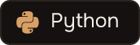&nbsp;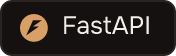&nbsp;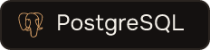&nbsp;&nbsp;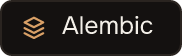&nbsp;&nbsp;

**AI, ML & Data**

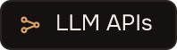&nbsp;&nbsp;&nbsp;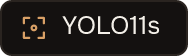&nbsp;&nbsp;&nbsp;

**Cloud & DevOps**

&nbsp;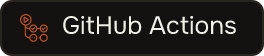&nbsp;&nbsp;&nbsp;&nbsp;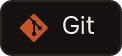

**Frontend, Mobile & Desktop**

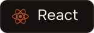&nbsp;&nbsp;&nbsp;&nbsp;&nbsp;

## Credentials & Registered IP

<a href="https://new.fips.ru/registers-doc-view/fips_servlet?DB=DB&DocNumber=2026624059&TypeFile=html">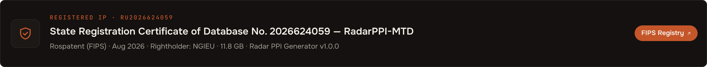</a>

<table>
<tr>
<td width="49.2%" valign="top"><a href="https://www.linkedin.com/learning/certificates/7dbcfe3d6e75e230a455c69fc572a2bf422822b777cc40686c8ec1b220177967/">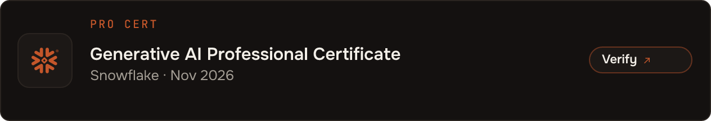</a></td>
<td width="49.2%" valign="top"><a href="https://www.linkedin.com/learning/certificates/3da5e65791016cdc89e7f42a986a37c699f119cf7b6f90ac683362857740c3f7/">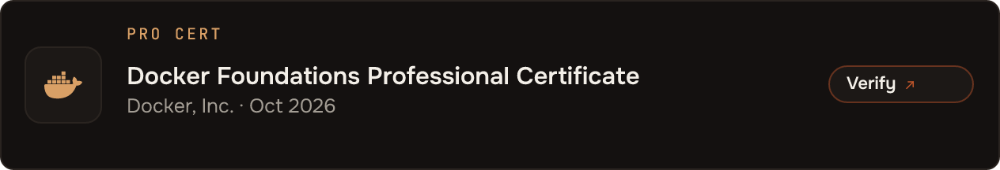</a></td>
</tr>
<tr>
<td width="49.2%" valign="top"><a href="https://www.linkedin.com/learning/certificates/1e5b63d85c89c9efa42594708e819226f4036646c14fd345356a085d3f5b58e6/">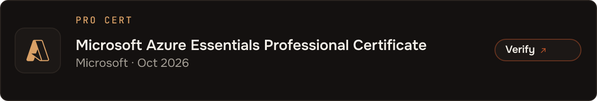</a></td>
<td width="49.2%" valign="top"><a href="https://www.linkedin.com/learning/certificates/5ee9bbacfc5a96408649fbb18ec701032c546fcc574f4395c077ae8cef0aed48/">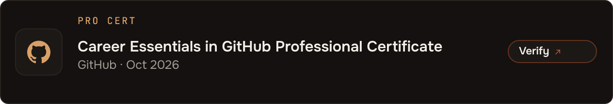</a></td>
</tr>
<tr>
<td width="49.2%" valign="top"><a href="https://www.linkedin.com/learning/certificates/7432d7674af7d7e569f163ae9668c3a290d63075ec99cac1e8f563783c4bb768/">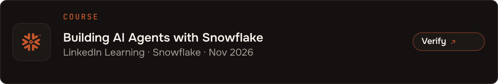</a></td>
<td width="49.2%" valign="top"></td>
</tr>
</table>

